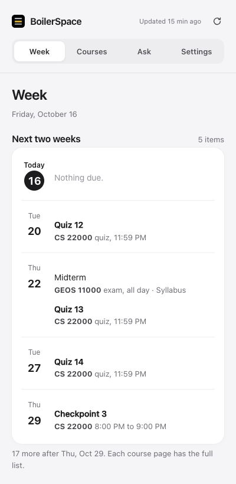
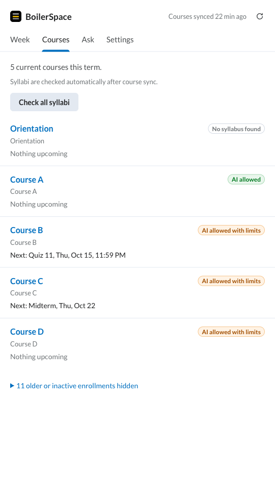
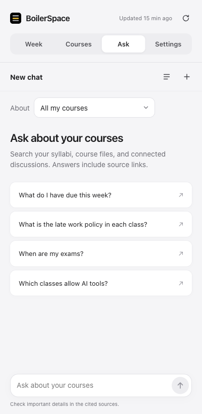
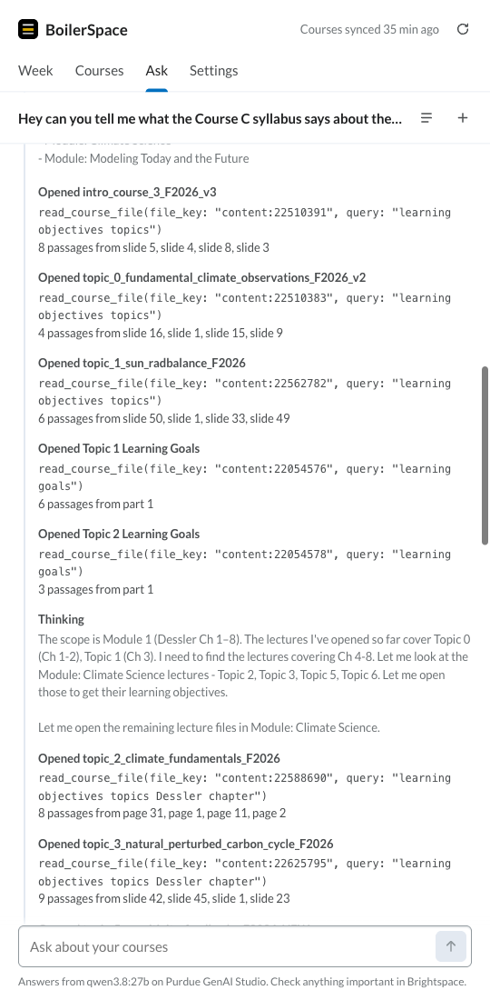

# BoilerSpace

[](https://github.com/ltmerletti/BoilerSpace/actions/workflows/ci.yml)

Your Purdue Brightspace courses, deadlines, syllabi, and course questions in one side panel.

BoilerSpace is a browser extension for Chrome, Firefox, and Zen. It reads your current courses from Brightspace, finds syllabi, and answers questions with citations through your own Purdue GenAI Studio account. There is no separate BoilerSpace account or server.

<p align="center">
  
  
  
</p>

*Screenshots are from the running extension with real saved course data. Visible course names and identifiers were renamed in the page HTML for privacy. Automatic background work was paused in the screenshot tab; the interface and saved content were otherwise unchanged.*

## What it does

- **Week:** upcoming assignments, quizzes, and exams, plus syllabus dates verified against their source wording. Clear dates appear and export automatically. If sources disagree, the agenda uses Brightspace and keeps the discrepancy available to inspect.
- **Courses:** current enrollments, upcoming work, syllabus text, and cited policy summaries. Syllabi are checked automatically, including Purdue Simple Syllabus pages.
- **Ask:** questions about your course material, with citations to the source page or item. Conversations can be revisited and answers retried.
- **Settings:** connect Brightspace, GenAI Studio, Ed, and Piazza. Expand a connection row for account details and course-link overrides. Export a calendar below the connections. Local data tools are under **Advanced**.

Course sync and syllabus reading run separately. Assignments and announcements can finish syncing while a slow syllabus page is still loading. Some courses have no syllabus; a confirmed missing syllabus is shown separately from a failed check.

## Ed and Piazza beta

In **Settings**, choose **Connect** on the Ed or Piazza row and approve site access. Ed discovers your active US courses. Piazza finds visible class links and the open class in your signed-in Piazza page, so pasting a URL is usually unnecessary. **Add a class by link** remains available inside the Piazza row when needed.

Connections use your existing sign-ins. If a sign-in is needed, it opens in a site tab and connecting resumes automatically afterward. The browser sidebar connects directly; the panel embedded in Brightspace uses a short extension-tab handoff for the permission request. History imports continue in the open panel after that handoff closes.

Ed and Piazza courses match current Brightspace courses using course codes first, then distinctive titles with minor spelling differences. Explicitly older terms and ambiguous matches stay separate. **Connection row → Options → Brightspace course** provides an optional override, which later syncs preserve. Courses connected before Brightspace is loaded are matched when their metadata becomes available.

The beta imports **the full available discussion history**, including available replies, in batches. It saves progress after each batch and resumes interrupted imports on the next sync. Later syncs check every history page and only reopen new or changed posts. Settings shows the saved post count and whether the history check is complete. Ask can search those saved posts, open a saved thread, distinguish staff replies from student suggestions, and cite the original Ed/Piazza link. Course pages offer a collapsed list of posts from the last seven days, sorted by posting date. Ask still searches the complete saved history. Discussion sync has its own status and **Sync discussions now** control; it refreshes independently at most every 20 minutes while BoilerSpace is open.

The beta does not read attachments, post, reply, or vote. It excludes private and deleted posts. Site changes can interrupt the reader; a failed refresh keeps the last successful posts and shows an error. Relevant discussion text may be sent to Purdue GenAI Studio when you ask. See [Privacy](PRIVACY.md#optional-ed-and-piazza-beta).

## Local discussion search

Saved Ed/Piazza posts use **BM25 plus POTION semantic search**, running locally in a browser worker. This finds both exact terms and related wording. The bundled int8 model is about 33 MB; it needs no model account, external search service, GPU, or first-run download. The worker loads when discussion search is used and releases its memory after a minute of inactivity. Other course material continues to use keyword search.

The assistant receives up to 6,000 characters of discussion evidence, with instructor/student roles and links to the original posts. If the semantic model cannot load, keyword search remains available and the tool reports that fallback. Search candidates can still be irrelevant; the assistant must check their content and saved-history status.

See [Discussion search and benchmark results](experiments/discussions/README.md) for the production choice, all aggregate comparisons, browser measurements, limitations and test commands. Benchmark evidence recall measures whether labeled source text reaches the assistant, not whether every generated answer is correct.

## Ask across your course material

> Hey can you tell me what the Course C syllabus says about the midterm, what it covers, and what I should review in the course materials?

Ask can search your course material, open relevant files, read syllabus pages and lecture slides, and bring the findings into one answer. The expandable work log shows its actual lookups, and citations let you check each finding against the source.

Chats receive short model-generated titles. Interim commentary stays in the work log, and you can scroll back while an answer streams. Completed quiz reviews can be read when Brightspace makes their questions visible, including reviews whose student API access is restricted.

The composer offers a thinking control for recognized models. **Default** sends no reasoning override. Qwen3.8 supports Quick (thinking off), Low, Medium and XHigh; its [published default is XHigh](https://huggingface.co/Qwen/Qwen3.8-27B#api-usage). Purdue's configured model remains in charge when Default is selected.

The example above comes from a real midterm question. BoilerSpace opened the syllabus and the relevant lecture material before answering. The expanded lookup below shows that run, with the course renamed **Course C**.

<details>
  <summary>See part of the actual lecture-material lookup</summary>
  <p></p>
</details>

## Install

This is a source installation. The extension has no build step, and Node.js is not needed to use it.

1. [Download the source ZIP](https://github.com/ltmerletti/BoilerSpace/archive/refs/heads/main.zip) and extract it, or clone the repository:

   ```sh
   git clone https://github.com/ltmerletti/BoilerSpace.git
   cd BoilerSpace
   ```

2. Load the `extension` folder using your browser's instructions below.
3. Sign into [Purdue Brightspace](https://purdue.brightspace.com), open BoilerSpace, and use **Connect** to link [Purdue GenAI Studio](https://genai.rcac.purdue.edu). Complete any Purdue sign-in prompts in the browser.
4. Allow the requested access to Brightspace, GenAI Studio, and Purdue Simple Syllabus.

### Chrome

Open `chrome://extensions`, enable **Developer mode**, choose **Load unpacked**, and select the `extension` folder. Keep that folder in place after installation.

### Firefox and Zen

Open `about:debugging#/runtime/this-firefox`, choose **Load Temporary Add-on**, and select `extension/manifest.json`. Temporary add-ons are removed when the browser quits; load it again next session.

### Open and update BoilerSpace

On Brightspace, click **BoilerSpace** in the navigation bar or use the arrow at the edge of its panel. The browser toolbar button also opens it: a side panel in Chrome, or a sidebar in Firefox and Zen.

After updating the source, reload the existing extension entry in `chrome://extensions` or `about:debugging`, then refresh Brightspace. Refreshing the website alone does not load updated extension scripts.

## Browser support

The manifest targets Chrome 116+ and Firefox 128+, including compatible Zen versions. Use a current browser release.

| Browser | Verification |
| --- | --- |
| Chrome / Chromium | Automated UI checks and signed-in live tests |
| Zen | Signed-in user session and full discussion-retrieval replay |
| Firefox | Automated discussion-worker checks in CI; full signed-in Purdue UI coverage remains through Zen |

BoilerSpace is currently specific to Purdue's Brightspace, Simple Syllabus, and GenAI Studio domains. Other universities' Brightspace installations are not configured.

## Syllabi and citations

After course sync, BoilerSpace checks syllabi for every current course. It can read files in Content, course overview attachments, and the **Syllabus** navigation tab, including its JavaScript-rendered Simple Syllabus document.

If you see **Allow Simple Syllabus access**, click it to open the extension's permission page, then approve access there. Granting permission starts a retry automatically. A site-permission problem cannot be fixed by repeatedly checking individual courses.

Temporary network or loading failures get one retry after the other courses finish. A completed search that finds no syllabus is remembered for a day. Use **Courses → Check again** for a fresh pass, or the course's **Check again** / **Read again** control to retry one course. If the automatic choice is wrong, select another course file or upload the syllabus.

Answers cite the material they used. Overview PDFs open in BoilerSpace's document reader at the cited page, and **Show original PDF** opens the source through your signed-in session. Check important dates and policies against the cited material.

## Data and permissions

Course data, conversations, settings, and the GenAI Studio API key are stored locally in the browser's extension storage. Syllabus text is sent to Purdue GenAI Studio to extract dates and policies. Questions, relevant course material, and conversation context are sent there to answer questions. Grade records are excluded from model requests.

| Site access | Purpose |
| --- | --- |
| `purdue.brightspace.com` | Sync courses and read course material through your signed-in session |
| `purdue.simplesyllabus.com` | Read the rendered syllabus launched by Brightspace |
| `genai.rcac.purdue.edu` | Connect your account and request model responses |
| `edstem.org`, `us.edstem.org` (optional) | Import saved public Ed posts and replies when connected |
| `piazza.com` (optional) | Import a connected class's public posts and replies |

BoilerSpace does not add its own analytics or send data to a separate BoilerSpace server. Exports can contain course content and conversation history. See [Privacy](PRIVACY.md) for storage, exports, and deletion details.

## Current limits

- Supported document formats include PDF, `.pptx`, `.docx`, and HTML. Scanned PDFs without readable text, old `.ppt` files, `.rtf`, video, and arbitrary external websites are not supported.
- The extension stays off quiz attempt pages. The assistant's quiz reader excludes scores and uses finished attempts or closed quizzes.
- The default model is `qwen3.8:27b`; availability and response speed depend on Purdue GenAI Studio. Change the model in Settings.
- This is an independent project, not an official Purdue or D2L product.

## Development and feedback

See [Contributing](CONTRIBUTING.md) for test setup, local browser checks, and signed-in live verification. The benchmark suite has its own [guide](bench/README.md); its private captures and cases are not included in a clone.

Report reproducible bugs or suggest changes through [GitHub Issues](https://github.com/ltmerletti/BoilerSpace/issues). Follow the [security reporting instructions](SECURITY.md) for vulnerabilities, and remove personal course information from screenshots and logs. Project participation follows the [code of conduct](CODE_OF_CONDUCT.md).

## License and credits

Copyright (C) 2026 Luke Merletti. BoilerSpace's original code is licensed under the **GNU General Public License, version 3 only** (`GPL-3.0-only`). See [LICENSE](LICENSE). The extension directory also includes [COPYING](extension/COPYING) and [NOTICE](extension/NOTICE) so its license travels with the installable files.

Bundled libraries and fonts retain their own licenses. See [Third-party notices](THIRD_PARTY_NOTICES.md). The project license does not grant rights to instructors' course documents, third-party services, or their trademarks.
