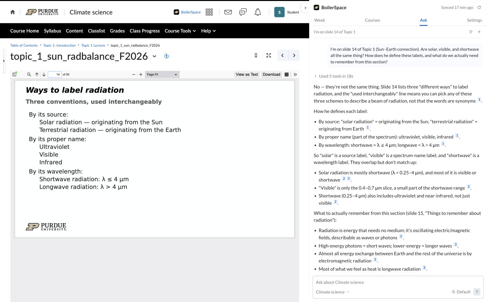
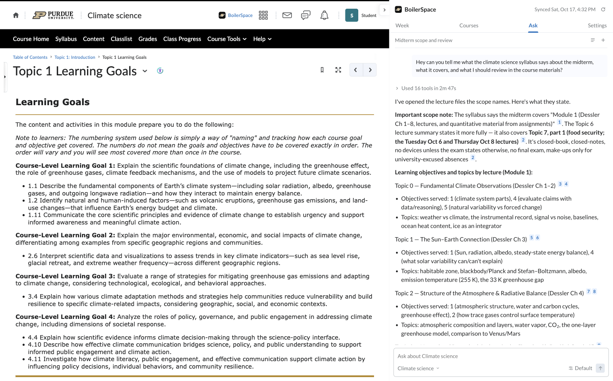
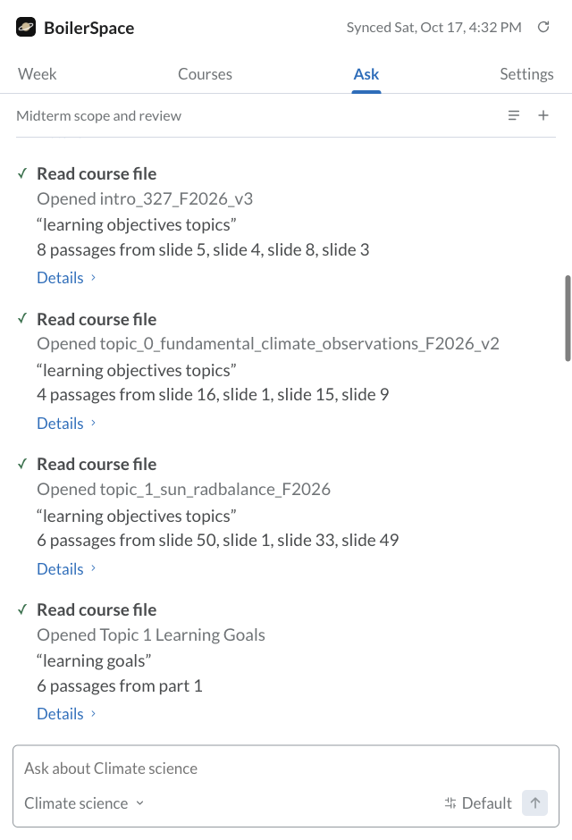
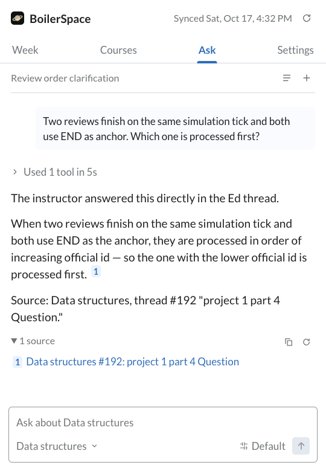
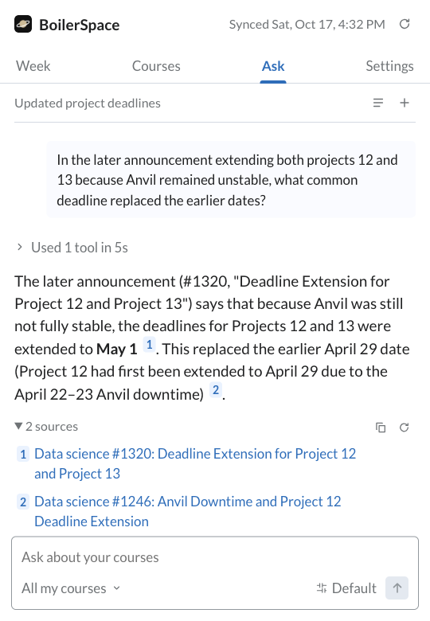

  

<h1 align="center">BoilerSpace</h1>

Ask questions about your Purdue courses, right in Brightspace.

  <a href="#get-started">Get started</a> · <a href="docs/USER_GUIDE.md">User guide</a> · <a href="CHANGELOG.md">Changelog</a>

  
  

## Make sense of the slide in front of you

> I'm on slide 14 of Topic 1. Are solar, visible, and shortwave all the same thing? How does he define these labels, and what do we actually need to remember?

BoilerSpace opens the slide, checks the neighboring material, and reads the lecture's learning goals. Here, it separates the three labeling schemes and finds the instructor's own "Things to remember" slide.

You can ask a follow-up without leaving the lecture or starting a new conversation.

## Go from exam scope to a review plan

> What does the syllabus say about the midterm, what does it cover, and what should I review in the course materials?

One question can take BoilerSpace through the syllabus, lecture decks and learning objectives. In this conversation, it also caught an extra topic included in a later lecture summary and linked both sources.

See the lecture-by-lecture lookup

## Find the detail buried in Ed or Piazza

**Ed.** Two project events finish on the same tick. Which gets processed first? BoilerSpace finds the instructor's tie-breaking rule and links the reply.

**Piazza.** A later announcement extends two projects again. BoilerSpace finds the revised deadline and distinguishes it from the earlier extension.

  
  

Search covers the full saved public history, including older threads and available replies. Connect Ed or Piazza in Settings using your existing sign-ins; clear course matches link to Brightspace automatically.

## Your week, in one place

Assignments, quizzes, exams and syllabus dates come together in **Week**. **Courses** keeps your current classes and syllabi close by. Export upcoming work to your calendar when you need it elsewhere.

## Get started

BoilerSpace works in **Chrome, Firefox and Zen**. You need your Purdue Brightspace and [GenAI Studio](https://genai.rcac.purdue.edu) accounts.

1. **[Download the source ZIP](https://github.com/ltmerletti/BoilerSpace/archive/refs/heads/main.zip)** and extract it.
2. **Load the `extension` folder** using your browser's instructions below.
3. **Open Brightspace**, click **BoilerSpace**, and connect Purdue GenAI Studio in **Settings**. Approve the requested access. Ed and Piazza are optional connections in the same place.

| Browser | Load the extension |
| --- | --- |
| **Chrome** | Open `chrome://extensions`, enable **Developer mode**, then choose **Load unpacked** and select the `extension` folder. |
| **Firefox / Zen** | Open `about:debugging#/runtime/this-firefox`, choose **Load Temporary Add-on**, and select `extension/manifest.json`. Reload it after quitting the browser. |

Keep the extracted folder in place. There is no build step or separate BoilerSpace account.

[Setup, updates and troubleshooting →](docs/USER_GUIDE.md)

---

[Changelog](CHANGELOG.md) · [Contributing](CONTRIBUTING.md) · [Privacy](PRIVACY.md) · [Security](SECURITY.md) · [Screenshot notes](docs/images/README.md)

[GPL-3.0-only](LICENSE) · Copyright © 2026 Luke Merletti · [Third-party notices](THIRD_PARTY_NOTICES.md)
