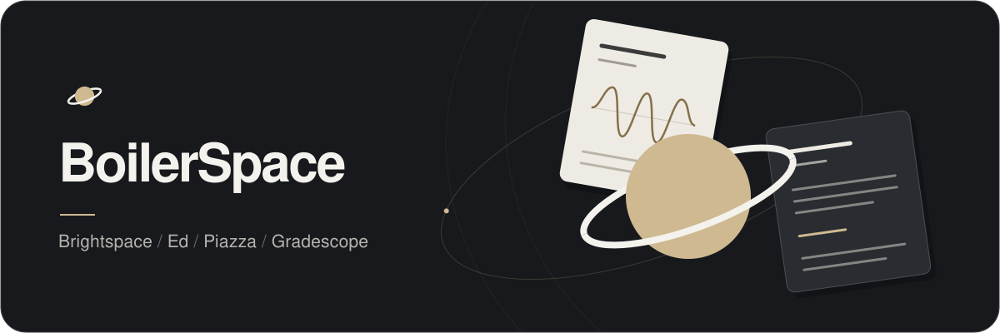
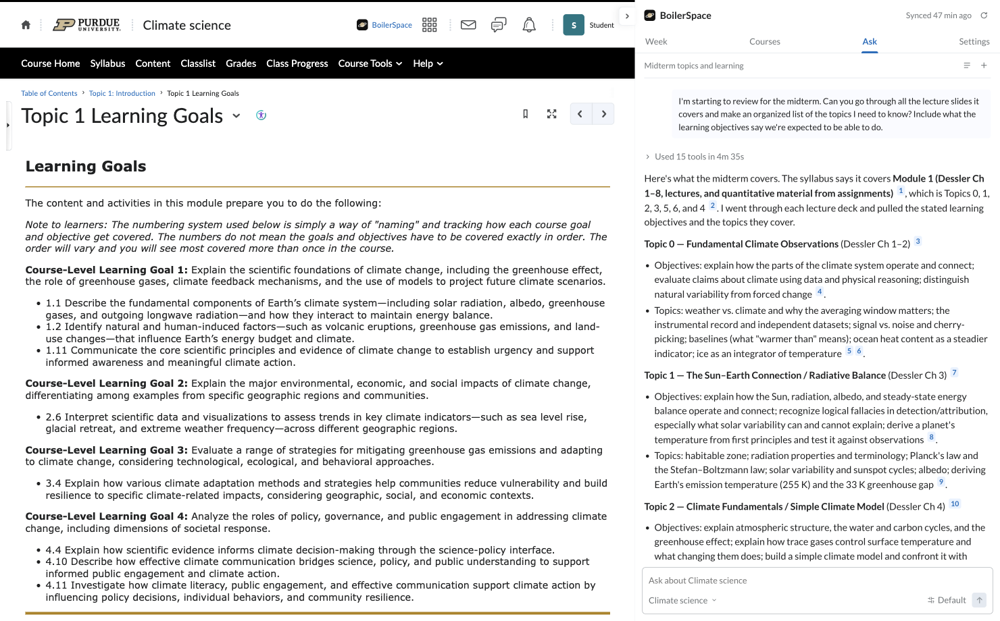
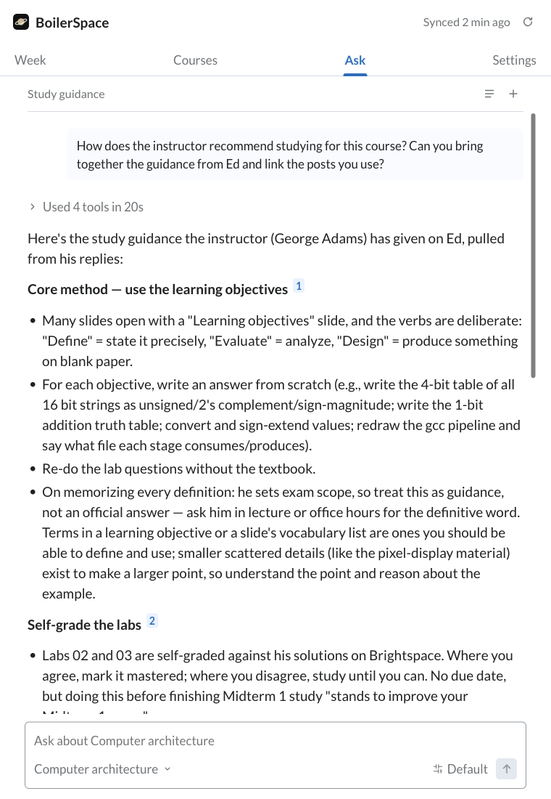

  

<h1 align="center">BoilerSpace</h1>

Ask questions about your Purdue courses, right in Brightspace.

  <a href="#get-started">Get started</a> · <a href="docs/USER_GUIDE.md">User guide</a> · <a href="CHANGELOG.md">Changelog</a>

  
  

## Understanding lecture material

> I'm on slide 14 of Topic 1. Are solar, visible, and shortwave all the same thing? How does he define these labels, and what do we actually need to remember?

BoilerSpace opens the slide, checks the neighboring material, and reads the lecture's learning goals. Here, it separates the three labeling schemes and finds the instructor's own "Things to remember" slide.

You can ask a follow-up without leaving the lecture or starting a new conversation.

## Reviewing for an exam

> I'm starting to review for the midterm. Can you go through all the lecture slides it covers and make an organized list of the topics I need to know? Include what the learning objectives say we're expected to be able to do.

BoilerSpace checks the syllabus for scope, then works through lecture slides, notes and learning objectives to collect the topics and what students are expected to do with them.

## Ed and Piazza discussions

> How does the instructor recommend studying for this course? Can you bring together the guidance from Ed and link the posts you use?

BoilerSpace searches the saved discussions and reads the relevant replies, with links back to the posts behind its answer.

The same search works with Piazza. It covers the full saved public history, including older threads and available replies. Connect Ed or Piazza in Settings using your existing sign-ins; clear course matches link to Brightspace automatically.

## Assignments and upcoming dates

Assignments, quizzes, exams and syllabus dates come together in **Week**. Connect **Gradescope** in Settings to include its assignments and published deadlines alongside Brightspace. Clear course matches link to Brightspace automatically. Ask can look up assignment dates with links back to Gradescope.

**Courses** keeps your current classes, syllabi and connected assignment lists close by. Export upcoming work to your calendar when you need it elsewhere.

## Get started

BoilerSpace works in **Chrome, Firefox and Zen**. Use your Purdue Brightspace account, and connect [GenAI Studio](https://genai.rcac.purdue.edu) or an OpenAI-compatible API for course answers.

The Firefox Add-ons release is being prepared. The manual installation below is available now; temporary Firefox installs are removed when the browser quits.

1. **[Download the source ZIP](https://github.com/ltmerletti/BoilerSpace/archive/refs/heads/main.zip)** and extract it.
2. **Load the `extension` folder** using your browser's instructions below.
3. **Open Brightspace**, click **BoilerSpace**, and connect Purdue GenAI Studio in **Settings**. You can also choose **OpenAI-compatible API** and enter your own API URL, key and model. Approve the requested access. Ed, Piazza and Gradescope are optional connections in the same place.

| Browser | Load the extension |
| --- | --- |
| **Chrome** | Open `chrome://extensions`, enable **Developer mode**, then choose **Load unpacked** and select the `extension` folder. |
| **Firefox / Zen** | Open `about:debugging#/runtime/this-firefox`, choose **Load Temporary Add-on**, and select `extension/manifest.json`. Reload it after quitting the browser. |

Keep the extracted folder in place. There is no build step or separate BoilerSpace account.

[Setup, updates and troubleshooting →](docs/USER_GUIDE.md)

---

[Changelog](CHANGELOG.md) · [Contributing](CONTRIBUTING.md) · [Privacy](PRIVACY.md) · [Security](SECURITY.md) · [Screenshot notes](docs/images/README.md)

[GPL-3.0-only](LICENSE) · Copyright © 2026 Luke Merletti · [Third-party notices](THIRD_PARTY_NOTICES.md)
