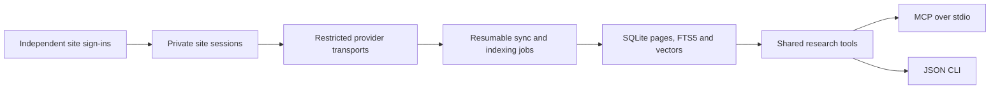

# BoilerSpace companion

Give a local agent the same course research tools as BoilerSpace: Brightspace files and syllabi, Ed and Piazza discussions, Gradescope deadlines, past quiz questions and page images. The companion has independent sign-ins and a persistent local index. The extension does not need to be installed or running.

MCP and the CLI use the same tools. The companion does not need a GenAI Studio key, call a language model, or run a public server.

## Set up

Use Node.js 22.13 or later. Clone the **full BoilerSpace repository** and keep it in place. This package shares document readers and bundled search assets with the extension's source code.

From the repository root:

```sh
npm ci --prefix mcp
cd mcp
npx --no-install playwright install chromium
node cli.mjs login
node cli.mjs call refresh_courses --wait
```

Sign into Purdue in the new window. It closes after the companion verifies the connection. You can pass `--browser /absolute/path/to/chrome` to use an installed Chromium browser for this separate profile.

Connect the other services with their own sign-ins:

```sh
node cli.mjs login --site ed
node cli.mjs login --site piazza
node cli.mjs login --site gradescope
node cli.mjs call connect_integration --args '{"platform":"ed"}' --wait
node cli.mjs call connect_integration --args '{"platform":"piazza"}' --wait
node cli.mjs call connect_integration --args '{"platform":"gradescope"}' --wait
```

`login --site all` walks through all four sign-ins. Clear course-code and term matches link automatically. Unmatched discussion and Gradescope courses remain available by source ID; `link_integration_course` can correct a match or keep a course independent.

On Linux, Playwright may also need system libraries. Use its [browser installation instructions](https://playwright.dev/docs/browsers#install-system-dependencies).

### Connect an MCP client

For Codex, register the local command with an **absolute path**:

```sh
codex mcp add boilerspace -- node /absolute/path/to/BoilerSpace/mcp/cli.mjs serve
```

The equivalent configuration for an MCP client that launches stdio servers is:

```json
{
  "mcpServers": {
    "boilerspace": {
      "command": "node",
      "args": ["/absolute/path/to/BoilerSpace/mcp/cli.mjs", "serve"]
    }
  }
}
```

Client configuration formats differ. The important settings are the command, arguments and stdio transport. Codex setup follows its [official MCP documentation](https://learn.chatgpt.com/docs/extend/mcp?surface=cli).

Each client must run on a machine that can access the repository and the saved companion data. This command does not expose your local index to a remote web client.

## Use it

Ask your agent something that requires reading the material:

> Find the posted scope for my first exam. Go through the lectures it covers and build a topic outline with the learning objectives. Tell me which documents you couldn't read, and cite the pages behind the outline.

The `exam-review` MCP prompt provides that workflow. The tools let an agent check the inventory, index missing files, search, read complete pages and build an evidence packet before answering.

| Task | Tools |
| --- | --- |
| Inspect connection and freshness | `connection_status`, `list_courses` |
| Find course material | `list_course_sources`, `course_coverage` |
| Refresh metadata or index documents | `refresh_courses`, `index_course` |
| Follow long operations | `job_status`, `cancel_job`, `resume_job` |
| Retrieve evidence | `search_course_material`, `read_document`, `research_context` |
| Read assignments and dates | `list_items`, `get_item`, `list_upcoming`, `list_gradescope_assignments` |
| Read course news | `list_announcements` |
| Read discussions and replies | `list_discussions`, `read_discussion` |
| Open files and page images | `list_course_files`, `read_course_file` |
| Read released quiz questions | `read_quiz` |
| Read syllabus policies and dates | `discover_syllabus`, `get_syllabus_facts`, `save_syllabus_facts` |
| Manage outside integrations | `connect_integration`, `link_integration_course`, `disconnect_integration` |

Search and `read_document` results include the source URL, page or slide label, text hash, document hash and indexing time. `read_document` accepts the document hash from a search result and rejects a read if that document changed. Long pages have continuation offsets instead of silently losing their trailing text.

`research_context` returns a bounded packet of evidence across matching pages. It does not write an answer. The client model still needs to interpret the evidence, check whether it supports a claim, and cite it.

### Use the CLI directly

Run these from `mcp/`. Replace the example course and source IDs with values returned by your index.

```sh
node cli.mjs call list_courses
node cli.mjs call list_course_sources --args '{"courseId":123,"kind":"file"}'
node cli.mjs call index_course --args '{"courseId":123}' --wait
node cli.mjs call search_course_material --args '{"courseId":123,"query":"first exam scope"}'
node cli.mjs call read_document --args '{"sourceId":"file:123:456"}'
node cli.mjs call read_document --args '{"sourceId":"file:123:456","page":1}'
```

For a few documents, pass `sourceIds` to `index_course`. Omit it to index all stale files in the course. `force: true` downloads unchanged files again, which is useful when the instructor replaced a file without updating its metadata.

The MCP process runs queued jobs in the background. A CLI invocation needs `--wait` to keep running until its job finishes. Without it, the job stays durable and can be picked up by the next `serve` process or another waiting job command. A completed job can still have per-file or metadata failures; check its `failures` and the coverage audit.

## What it reads

The first version supports **current Purdue Brightspace courses**. It discovers supported API versions and reads course names, content structure, posted assignment and quiz instructions, announcements, calendar events, overview text and attached course files.

PDFs retain page locations. Modern Word and PowerPoint files, RTF, HTML, plain text, source files, supported text datasets and notebook cells use the shared BoilerSpace readers. Downloads use the shared 100 MB limit, or 200 MB for Office ZIP containers. Parsing is limited to 2,000 pages, eight million text characters and 30 seconds per file. Notebook cells and source files are read as text. They are never executed.

Ed and Piazza use the extension's full-history reader and normalizers. Imports retain public post text, available replies, instructor/student roles, endorsements, timestamps and original thread links. They checkpoint their cursor and version map, detect repeated pages, keep earlier posts after a failed request, and remove withdrawn posts after a completed sweep. An import can take several minutes, especially on Piazza. Inspect its job and `history_complete` before treating search as comprehensive. Attachments and discussion images stay on the original sites, as in the extension.

Gradescope uses the same parser as the extension. It imports current-term course links, assignment names and published release, normal due and late due dates. It removes score and submission-status elements before extracting those fields. It does not open submissions or grading feedback, read scores, or infer missing dates.

`read_quiz` uses the extension's completion gate. It can read released question text from a finished attempt or a closed quiz. Only question text and displayed choices are returned; scores, selected student answers, correctness flags and answer keys are excluded. An open quiz without a finished attempt remains hidden.

`read_course_file` accepts the extension's `file_key`, `location`, `offset` and `see_images` arguments. Image reads render a PDF page or extract pictures from the chosen PowerPoint slide locally. MCP returns actual image content blocks. A vision-capable client model must interpret those images; the companion does not send them to an OCR or model API.

For a syllabus, the agent can call `discover_syllabus`, read the discovered file, and extract policies and dates with its own model. `save_syllabus_facts` accepts the structured extraction and the document hash, verifies every supporting quote against the saved text, and reports unsupported claims it dropped. The saved facts feed `get_syllabus_facts`, course AI-use policies and upcoming syllabus dates. Replacing the source invalidates old facts. Discovery reuses an indexed syllabus and returns its indexing time; pass `refresh: true` to read the current portal version again.

Routine syncs and searches use direct requests without site tabs. An explicit syllabus read can launch an isolated headless renderer for the Brightspace LTI/Simple Syllabus page, then close it. It uses a temporary profile with the companion's Purdue cookies and never attaches to a personal browser. Other external links remain in the inventory but are not downloaded. The companion does not submit, post, vote or change coursework.

## Recovery and data

The default data directory is `~/.local/share/boilerspace-companion`, or `$XDG_DATA_HOME/boilerspace-companion` when set. Override it with `BOILERSPACE_DATA_DIR` or `--data-dir`. Use the same directory for login, CLI calls and the MCP client.

Each site connection is bound to one verified account using a local identifier hash. Signing into another account for that site is refused before replacing its saved session. Use another data directory for another account. Logout keeps account bindings with the cache. Ed tokens, Piazza/Gradescope cookies and the Brightspace session are saved separately.

| Situation | What happens |
| --- | --- |
| Purdue sign-in expires | Cached searches and reads still work. Run `login` again, then resume the failed job. An already-running MCP process detects the new sign-in. |
| A file fails | The job records its failure and continues with other files. Run `index_course` again to retry files still missing. |
| A sync section fails | Its earlier sources stay available. Sync errors remain visible rather than replacing that section with an empty inventory. |
| The process stops | A clean shutdown releases its job for immediate recovery. After a crash, another worker can resume after the two-minute lease expires. |
| You cancel indexing | Finished files stay indexed. A job owned by another process observes cancellation on its next checkpoint, with a heartbeat every ten seconds. |
| A document changes | Its previous passages and vectors are invalidated. Old evidence hashes no longer pass a pinned read. |

Refreshes are explicit. Cached material does not update just because an agent searches it. Search results and coverage include the last sync time so the agent can decide when to refresh.

`logout` removes the Brightspace session and its separate browser profile. Use `logout --site ed`, `piazza` or `gradescope` for a particular provider, or `logout --site all` to remove every saved sign-in. Logout **keeps indexed course material**. `disconnect_integration` removes both that platform's cached material and its credentials. To remove all Brightspace material as well, stop companion processes and delete the chosen data directory. Extension storage is separate.

Cookies, the Brightspace XSRF token, the Ed authentication token and the dedicated sign-in profiles are local credentials. The data directory uses owner-only Unix permissions; it is not an encrypted vault. Session files and course caches must stay out of Git and shared folders. Windows users should use a directory protected by their account's access controls. The companion does not collect passwords or expose credentials through MCP tools.

Tool responses go to the MCP client you connect. That client can send course excerpts to its model provider under its own settings and privacy policy. See [the privacy policy](../PRIVACY.md#standalone-companion).

## How it works



- **Transport.** Authenticated requests are pinned to the service and a read-only route/method allowlist. Downloads are bounded while streaming. Piazza allows only known same-origin page redirects. Its read APIs use POST, as does authentication renewal; write methods are rejected. No session is forwarded to a foreign origin.
- **Storage.** SQLite publishes metadata and page replacements transactionally. Job leases prevent two processes from owning the same job. Checkpoints preserve the completed file cursor; source revisions prevent stale jobs from publishing an older document.
- **Retrieval.** SQLite FTS5 BM25 and the bundled local semantic encoder are combined with reciprocal rank fusion. Vectors persist in SQLite. Model assets are checked against pinned hashes, and keyword search stays available if semantic indexing fails.
- **Parsing.** Document parsing runs in a worker with a time limit. PDF decoding uses local PDF.js assets. The companion shares the other readers with the extension, so formats have one implementation.
- **Agent boundary.** Tools accept known course and source IDs, not arbitrary URLs or local paths. Course text is untrusted evidence. The MCP instructions and research prompt tell clients to retain citations, inspect coverage and disregard document instructions directed at the agent. A client model must still enforce that boundary.

This uses Purdue's signed-in web session and the same course API reader as the extension. It is not an institution-registered OAuth application. Changes to Purdue sign-in or Brightspace can require reader updates.

## Development and validation

From `mcp/`:

```sh
npm test
npm run test:browser
npm run eval -- eval-local.json
npm audit --audit-level=high
```

Run `npm run lint` from the repository root. CI checks the companion on Node 22 and 24, including the actual MCP stdio handshake, document parsers, session isolation, durable jobs and intercepted browser sign-ins for all four services. Those browser fixtures do not contact real accounts. Tests assert that every extension agent tool is exposed, and exercise full history, reply continuations, source scoping, course linking, quiz score exclusion, syllabus quote validation and actual MCP image blocks.

[The retrieval evaluation](eval/README.md) compares keyword and hybrid search on a checked-in synthetic corpus, including multi-document questions and course scoping. Its [recorded baseline](eval/baseline.json) includes per-question rankings and timings. It is a regression check, not a claim about real-course answer accuracy.

Live validation uses a separate, ignored data directory. It must not export course captures, credentials or raw API responses into the repository. The package is currently private and runs from a full checkout; it is not a published standalone npm distribution.
